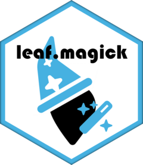
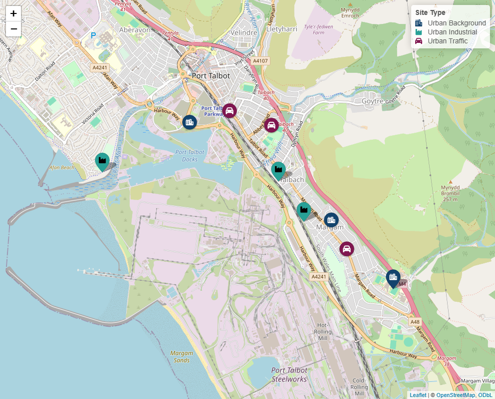

# {leaf.magic} - Use Modern Icon Libraries in Leaflet Markers <a href="https://jack-davison.github.io/leaf.magic/"></a>

<!-- badges: start -->
[](https://CRAN.R-project.org/package=leaf.magic)
[](https://github.com/jack-davison/leaf.magic/actions/workflows/R-CMD-check.yaml)
<!-- badges: end -->

The goal of `{leaf.magic}` is to overcome the somewhat outdated "Font Awesome" implementation in vanilla R `{leaflet}` by constructing SVG markers on the fly using modern icon libraries such as `{fontawesome}`, `{bsicons}` and `{lucidr}`. There are a few issues `{leaf.magic}` sets out to overcome:

* `leaflet::awesomeIcons()` is limited to Font Awesome 4 👎

* `leaflet::awesomeIcons()` is limited to a handful of discrete colours 👎

* `leaflet::awesomeIcons()` is limited to a single marker size and shape 👎

* Vanilla `{leaflet}` doesn't provide any additional features to construct legends, icon palettes, or such like 👎

`{leaf.magic}` attempts to solve all of this:

* `magicIcons()` uses up-to-date versions of Font Awesome, Bootstrap, Lucide, and Ionicons icons - or your own text and SVG icons ✅

* `magicIcons()` draws its own vector markers, so they can be any colour, size or shape (including shapes you design yourself) and stay sharp at any size ✅

* `{leaf.magic}` exports functions like `iconFactor()` and `addIconLegend()` to map data to icons and explain them to users, just like colours in `{leaflet}` ✅

## Installation

You can install the development version of `{leaf.magic}` like so:

``` r
# install.packages("pak")
pak::pak("jack-davison/leaf.magic")
```

## Example

Pass `magicIcons()` to the `icon` argument of `leaflet::addMarkers()`. Like `leaflet::awesomeIcons()`, its arguments can be formulas, which are evaluated using the map's data.

``` r
library(leaflet)
library(leaf.magic)

iconPal <- iconFactor(c("city", "industry", "car"), domain = port_talbot$site_type)
colPal <- colorFactor(c("#12436D", "#28A197", "#801650"), domain = port_talbot$site_type)

leaflet(port_talbot) |>
  addTiles() |>
  addMarkers(
    icon = magicIcons(
      icon = ~ iconPal(site_type),
      markerColor = ~ colPal(site_type),
      marker = ~ ifelse(open, "marker", "circle")
    ),
    popup = ~site
  ) |>
  addIconLegend(
    pal = iconPal,
    values = ~site_type,
    colors = colPal,
    title = "Site Type"
  )
```



`{leaf.magic}` is thoroughly documented on the [package website](https://jack-davison.github.io/leaf.magic/). Start with the [getting started guide](https://jack-davison.github.io/leaf.magic/articles/leaf-magic.html), then see the articles on [customising markers](https://jack-davison.github.io/leaf.magic/articles/markers.html) and [icon scales & legends](https://jack-davison.github.io/leaf.magic/articles/scales-and-legends.html).

## Attributions

`{leaf.magic}` is licensed under the [MIT License](https://jack-davison.github.io/leaf.magic/LICENSE.html), and would not be possible without the following icon libraries:

* **Font Awesome** - [Website](https://fontawesome.com/) | [License](https://fontawesome.com/license/free) | [R Package {fontawesome}](https://github.com/rstudio/fontawesome)

* **Bootstrap Icons** - [Website](https://icons.getbootstrap.com/) | [License](https://getbootstrap.com/docs/5.3/about/license/) | [R Package {bsicons}](https://github.com/rstudio/bsicons)

* **Lucide** - [Website](https://lucide.dev/) | [License](https://lucide.dev/license) | [R Package {lucidr}](https://github.com/hyperverse-r/lucidr/tree/main)

* **Ionicons** - [Website](https://ionic.io/ionicons) | [License](https://github.com/ionic-team/ionicons/blob/main/LICENSE)

## Code of Conduct

Please note that the leaf.magic project is released with a [Contributor Code of Conduct](https://jack-davison.github.io/leaf.magic/CODE_OF_CONDUCT.html). By contributing to this project, you agree to abide by its terms.
